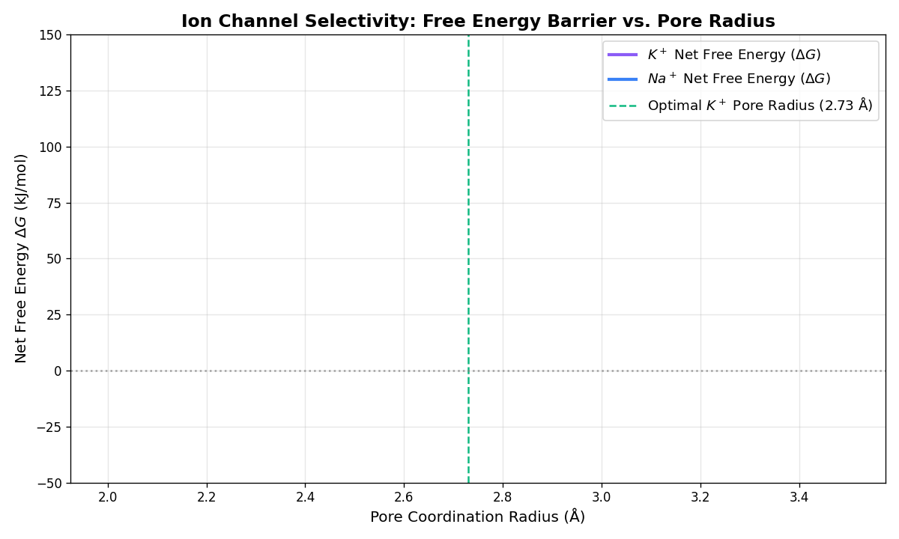

# Thermodynamic Selectivity in Ion Channels: $K^+$ vs. $Na^+$ Transport

---

## 1. Problem Formulation: Selective Ion Conduction

Voltage-gated potassium ($K^+$) channels conduct potassium ions across biological membranes at rates approaching the diffusion limit ($\sim 10^8 \text{ ions/s}$), while maintaining a selectivity factor of approximately $10,000:1$ over sodium ($Na^+$) ions.

From a simple steric perspective, this selectivity presents a counterintuitive observation:

* **Potassium ion radius ($r_{\text{K}^+}$):** $1.33 \text{ \AA}$
* **Sodium ion radius ($r_{\text{Na}^+}$):** $0.95 \text{ \AA}$

$$r_{\text{Na}^+} < r_{\text{K}^+}$$

If channel selectivity operated purely through size exclusion (a geometric aperture), any pore wide enough to admit $K^+$ ($r = 1.33 \text{ \AA}$) would physically accommodate the smaller $Na^+$ ion ($r = 0.95 \text{ \AA}$). 

Understanding why $Na^+$ is excluded requires examining the energetic balance between **ion hydration in aqueous solution** and **coordination within the channel's selectivity filter**.

---

## 2. Hydration Free Energy and Solvation Electrostatics

In bulk water, ions do not exist as isolated charges. Water molecules ($H_2O$) possess a strong permanent dipole moment ($\mu \approx 1.85 \text{ D}$). Electrostatic attraction causes water molecules to orient around the ion, forming a structured **hydration shell**.

### The Born Solvation Energy Equation

The free energy change associated with transferring a spherical ion of charge $q$ and radius $a$ from a vacuum into a continuous dielectric medium of dielectric constant $\varepsilon$ is described by the **Born Equation**:

$$\Delta G_{\text{solvation}} = -\frac{N_A q^2}{8 \pi \varepsilon_0 a} \left( 1 - \frac{1}{\varepsilon} \right)$$

Where:
* $N_A$: Avogadro's number ($6.022 \times 10^{23} \text{ mol}^{-1}$)
* $q$: Ion charge ($+1.602 \times 10^{-19} \text{ C}$)
* $\varepsilon_0$: Vacuum permittivity ($8.854 \times 10^{-12} \text{ F/m}$)
* $a$: Effective ionic radius ($a = r_{\text{ion}} + r_{\text{water}}$)
* $\varepsilon$: Relative permittivity of the solvent ($\approx 80$ for water at $298 \text{ K}$)

### Physical Significance of Ionic Radius on Hydration
Because the electric field strength at the ion surface scales inversely with radius squared ($E \propto \frac{1}{r^2}$), smaller ions generate significantly stronger local electric fields. 

Consequently, $Na^+$ binds surrounding water dipoles more tightly than $K^+$ does.

* **Hydration Free Energy of $K^+$ ($\Delta G_{\text{hyd, K}^+}$):** $\approx -295 \text{ kJ/mol}$
* **Hydration Free Energy of $Na^+$ ($\Delta G_{\text{hyd, Na}^+}$):** $\approx -405 \text{ kJ/mol}$

To enter a narrow transmembrane pore (where the lipid environment has a low dielectric constant $\varepsilon_{\text{membrane}} \approx 2$), the ion must shed its hydration shell. The energy required to strip this water is the positive inverse of the hydration energy:

$$\Delta G_{\text{dehydration}} = -\Delta G_{\text{solvation}}$$

$$\Delta G_{\text{dehyd, K}^+} = +295 \text{ kJ/mol}$$
$$\Delta G_{\text{dehyd, Na}^+} = +405 \text{ kJ/mol}$$

Stripping water from $Na^+$ costs **$110 \text{ kJ/mol}$ more energy** than stripping water from $K^+$.

---

## 3. Structural Mechanism of the Selectivity Filter

For an ion to cross the cell membrane without incurring a $300\text{--}400 \text{ kJ/mol}$ energetic penalty, the channel pore must compensate for the lost water coordination.

### The TVGYG Backbone Filter Structure
In $K^+$ channels (such as KcsA), the narrowest section of the pore is formed by a conserved amino acid sequence: `Thr-Val-Gly-Tyr-Gly` (**TVGYG**). 

The protein backbone is arranged such that the **carbonyl oxygen atoms ($C=O$)** point directly into the central conduction pathway. These oxygen atoms carry a partial negative charge ($\delta^- \approx -0.55\,e$) and form four surrogate coordination rings along the pore axis.

```
                  Top View of Coordination Site
                  
                     [Carbonyl Oxygen] (δ-)
                               │
   [Carbonyl Oxygen] (δ-) ─── K+ ─── [Carbonyl Oxygen] (δ-)
                               │
                     [Carbonyl Oxygen] (δ-)
```

### The Energetic Basis of Ion Discrimination

The selectivity filter relies on the **rigidity of the protein backbone scaffold**:

1. **Potassium Coordination ($r = 1.33 \text{ \AA}$):**
   * The distance between opposing carbonyl oxygens across the pore is fixed at approximately $2.84 \text{ \AA}$.
   * Adding the oxygen ionic radius ($1.40 \text{ \AA}$) to the potassium radius ($1.33 \text{ \AA}$) yields an optimal contact distance of $2.73 \text{ \AA}$.
   * $K^+$ fits precisely within the carbonyl ring. The electrostatic coordination energy provided by the carbonyl oxygens matches its hydration energy in bulk water:
     $$\Delta G_{\text{net, K}^+} = \Delta G_{\text{dehyd, K}^+} + \Delta G_{\text{coord, K}^+} \approx +295 - 295 = 0 \text{ kJ/mol}$$

2. **Sodium Coordination ($r = 0.95 \text{ \AA}$):**
   * $Na^+$ requires a shorter contact distance ($0.95 + 1.40 = 2.35 \text{ \AA}$) to achieve optimal electrostatic interaction.
   * Because the surrounding protein structure is rigid, the carbonyl oxygens cannot collapse inward to coordinate $Na^+$ without introducing significant structural strain in the protein backbone.
   * As a result, $Na^+$ sits in a pore that is too large for it. The carbonyl oxygens provide insufficient coordination energy to compensate for the higher dehydration cost:
     $$\Delta G_{\text{net, Na}^+} = \Delta G_{\text{dehyd, Na}^+} + \Delta G_{\text{coord, Na}^+} \approx +405 - 365 = +40 \text{ kJ/mol}$$



---

## 4. Quantitative Selectivity Ratio Derivation

The flux ratio of two competing ion species through a channel at thermal equilibrium is dictated by the difference in their net activation free energy barriers ($\Delta \Delta G$), following Boltzmann statistics:

$$\Delta \Delta G = \Delta G_{\text{net, Na}^+} - \Delta G_{\text{net, K}^+}$$

$$\Delta \Delta G \approx +40 \text{ kJ/mol} - 0 \text{ kJ/mol} = +40 \text{ kJ/mol}$$

The probability ratio of $Na^+$ vs. $K^+$ permeation at body temperature ($T = 310 \text{ K}$) is:

$$\frac{\text{Flux}_{Na^+}}{\text{Flux}_{K^+}} = \exp\left( -\frac{\Delta \Delta G}{R T} \right)$$

Where:
* $R = 8.314 \text{ J/(mol}\cdot\text{K)}$
* $T = 310 \text{ K}$
* $R T \approx 2.577 \text{ kJ/mol}$

$$\frac{\text{Flux}_{Na^+}}{\text{Flux}_{K^+}} = \exp\left( -\frac{40}{2.577} \right) = e^{-15.52} \approx 1.8 \times 10^{-7}$$

This $+40 \text{ kJ/mol}$ free energy difference accounts for the observed $>10,000:1$ selectivity factor of potassium channels over sodium.

---

## 5. Python Numerical Implementation

The following script models the net free energy profile for $K^+$ and $Na^+$ as a function of pore coordination radius.

```python
import numpy as np
import matplotlib.pyplot as plt

# Physical constants
EPSILON_0 = 8.854e-12    # Vacuum permittivity (F/m)
ELEMENTARY_CHARGE = 1.602e-19 # Charge of electron (C)
AVOGADRO = 6.022e23       # Avogadro's constant (1/mol)

# Ionic radii (Angstroms)
R_OXYGEN = 1.40
R_K = 1.33
R_NA = 0.95

# Experimental hydration free energies (converted to positive dehydration cost in kJ/mol)
DG_DEHYD_K = 295.0
DG_DEHYD_NA = 405.0

# Partial charge on carbonyl oxygen
Q_OXYGEN = -0.55 * ELEMENTARY_CHARGE

def calculate_coordination_energy(r_ion, pore_radius, n_contacts=8):
    """
    Calculates electrostatic coordination energy (kJ/mol) of an ion 
    surrounded by n_contacts carbonyl oxygen atoms at a given pore radius.
    """
    effective_distance = max(pore_radius, r_ion + R_OXYGEN) * 1e-10  # convert to meters
    
    # Coulombic potential energy sum
    e_joules = n_contacts * (ELEMENTARY_CHARGE * Q_OXYGEN) / (4 * np.pi * EPSILON_0 * effective_distance)
    e_kj_per_mol = (e_joules * AVOGADRO) / 1000.0
    return e_kj_per_mol

# Scan pore radii from 2.0 to 3.5 Angstroms
radii = np.linspace(2.0, 3.5, 300)

net_g_k = []
net_g_na = []

# Minimum rigid pore radius constraint set by protein scaffold (2.73 A)
MIN_RIGID_RADIUS = R_K + R_OXYGEN

for r in radii:
    # Potassium coordination energy
    e_coord_k = calculate_coordination_energy(R_K, r)
    g_k = DG_DEHYD_K + e_coord_k
    net_g_k.append(g_k)
    
    # Sodium coordination energy (subject to pore rigidity constraint)
    r_na_eff = max(r, MIN_RIGID_RADIUS)
    e_coord_na = calculate_coordination_energy(R_NA, r_na_eff)
    g_na = DG_DEHYD_NA + e_coord_na
    net_g_na.append(g_na)

# Plotting results
plt.figure(figsize=(9, 5.5), dpi=120)
plt.plot(radii, net_g_k, label=r"$K^+$ Net $\Delta G$", color="#6d28d9", linewidth=2)
plt.plot(radii, net_g_na, label=r"$Na^+$ Net $\Delta G$", color="#2563eb", linewidth=2)
plt.axvline(x=MIN_RIGID_RADIUS, color="#059669", linestyle="--", label=f"KcsA Pore Radius ({MIN_RIGID_RADIUS:.2f} Å)")

plt.title("Net Free Energy Barrier vs. Pore Coordination Radius", fontsize=13)
plt.xlabel("Pore Coordination Radius (Å)", fontsize=11)
plt.ylabel("Net Free Energy $\Delta G$ (kJ/mol)", fontsize=11)
plt.axhline(0, color="black", linestyle=":", alpha=0.5)
plt.legend(fontsize=10)
plt.grid(True, linestyle="--", alpha=0.5)
plt.tight_layout()
plt.savefig("ion_channel_selectivity_plot.png")
```

---

## 6. Summary of Key Principles

1. **Ion Selectivity is Thermodynamic, Not Purely Kinetic:** Channels discriminate ion species by comparing solvation free energies in bulk water against coordination free energies inside the pore.
2. **Dehydration Costs Scale Inversely with Radius:** Smaller ions ($Na^+$) hold water more strongly due to higher surface charge density, requiring higher energy to dehydrate.
3. **Scaffold Rigidity Determines Selectivity:** The selectivity filter protein backbone is rigid. It holds carbonyl oxygens at a fixed distance optimized for $K^+$, making it energetically unfavorable for smaller $Na^+$ ions to enter.
